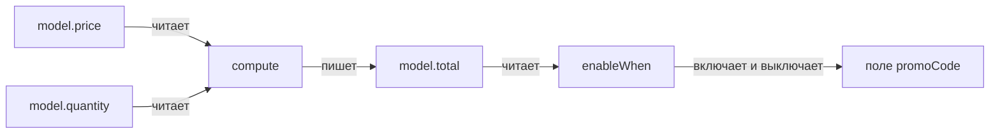
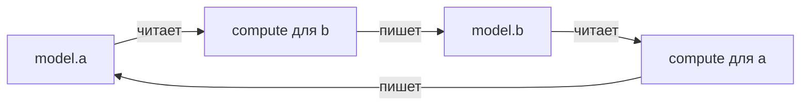

import OrderTotal from '@site/src/components/demo/live/behaviors/order-total';
import orderTotalSource from '@site/src/components/demo/live/behaviors/order-total.tsx?raw';

# Вычисляемые поля

Вычисляемое поле получает значение из других полей и пересчитывается само, когда они меняются.
Его описывает оператор [поведения](../reference/glossary.md) `compute` или `computeFrom`.

## Когда нужно

- Итог заказа — цена на количество.
- Ежемесячный платёж по сумме, сроку и ставке.
- Полное имя из фамилии и имени.
- Сумма по строкам массива.

## Пример

<LiveExample
  component={OrderTotal}
  source={orderTotalSource}
  caption="Что попробовать: поставьте количество 5 — итог станет 6000 ₽, и поле промокода включится. Верните 1 — промокод выключится и очистится."
/>

Что здесь происходит:

1. `compute(model.$.total, () => (model.price ?? 0) * (model.quantity ?? 0))` — итог. Оператор
   запоминает, какие поля прочитал, и пересчитывает итог, когда меняется любое из них.
2. `enableWhen(model.$.promoCode, () => model.total >= 5000, { resetOnDisable: true })` — промокод
   доступен только для крупного заказа. Условие читает вычисленный итог, поэтому реагирует на цену
   и количество через него.
3. Ключ `disabled: true` у узла итога делает поле только для чтения: значение пишет поведение.

## Какие поля читает и какое пишет



Оператор подписывается на поля, которые прочитал при последнем пересчёте. Цель в источники не
входит: `compute` для `total` не реагирует на запись в `total`. Записывает он только новое
значение — если результат не изменился, записи нет.

## compute

`compute(цель, read, { when? })` пишет в цель результат `read()`. Источники не перечисляются:
ими становятся поля, которые `read()` прочитал.

```typescript
import { compute, defineFormBehavior } from '@reformer/core/behaviors';

type Person = {
  personalData: { firstName: string; lastName: string };
  fullName: string;
};

const personBehavior = defineFormBehavior<Person>(({ model }) => {
  // Читать можно любые поля модели, в том числе вложенных групп.
  compute(model.$.fullName, () =>
    [model.personalData.firstName, model.personalData.lastName].filter(Boolean).join(' ')
  );
});
```

Тип результата задаёт поле: если `amount` — `number | null`, а `total` — `number`, вычисление
`() => model.amount` не скомпилируется.

## computeFrom

`computeFrom(источники, цель, fn, { when? })` — то же с явным списком источников. Значения
источников приходят в `fn` по порядку массива.

```typescript
import { computeFrom, defineFormBehavior } from '@reformer/core/behaviors';

const loanBehavior = defineFormBehavior<Loan>(({ model }) => {
  computeFrom(
    [model.$.loanAmount, model.$.loanTerm, model.$.interestRate],
    model.$.monthlyPayment,
    (amount, term, rate) => annuityMonthly(amount ?? 0, term ?? 0, rate ?? 0)
  );
});
```

Берите `compute` по умолчанию. `computeFrom` удобен, когда источники хочется перечислить явно, а
функцию расчёта — держать чистой: значения она получает аргументами и модель не читает.

## Условный пересчёт

Опция `when` пересчитывает поле, только пока условие истинно:

```typescript
compute(model.$.initialPayment, () => Math.round((model.propertyValue ?? 0) * 0.2), {
  when: () => model.loanType === 'mortgage',
});
```

Если то же поле выключает `enableWhen`, у `compute` должно быть то же условие в `when`. `compute`
не смотрит на доступность поля: без `when` он снова заполнит выключенное поле, и значение уйдёт в
отправку.

## Сумма по строкам массива

Агрегат по массиву читайте через массив модели `model.<массив>.map(...)`:

```typescript
compute(model.$.total, () =>
  model.items.map((item) => item.amount ?? 0).reduce((sum, amount) => sum + amount, 0)
);
```

`.map` подписывает и на состав массива (добавление, удаление, перестановку), и на поля строк,
которые прочитал колбэк. Только число строк — `model.items.length`.

## Цепочки

Если одно вычисляемое поле зависит от другого, опишите каждое своим `compute`. Порядок пересчёта
выстроится сам: цель одного — источник другого.

```typescript
const creditBehavior = defineFormBehavior<Credit>(({ model }) => {
  compute(model.$.monthlyPayment, () =>
    annuityMonthly(model.loanAmount, model.loanTerm, model.interestRate)
  );
  compute(model.$.paymentToIncome, () => model.monthlyPayment / (model.monthlyIncome || 1));
});
```

## Циклы

Цикл — когда два вычисления читают цели друг друга:



- **Цикл сходится**, если значения перестают меняться: очередной пересчёт даёт то же значение,
  записи нет, и цикл останавливается сам.
- **Цикл расходится**, если значения меняются бесконечно: `b = a + 1`, `a = b + 1`. Библиотека
  сигналов обрывает такой пересчёт, а оператор бросает ошибку с путём поля:
  `compute("a"): расходящийся цикл пересчёта`.

```typescript
// ❌ расходится — ошибка при первом пересчёте
compute(model.$.a, () => model.b + 1);
compute(model.$.b, () => model.a + 1);

// ✅ одно направление
compute(model.$.total, () => model.price * model.quantity);

// ✅ условие when останавливает пересчёт
compute(model.$.a, () => model.b + 1, { when: () => model.a !== model.b + 1 });
```

ИИ-ассистент с [MCP-сервером ReFormer](/docs/mcp/tools) проверяет граф заранее: инструмент
`validate_form` с `kind: 'behaviors'` находит циклы по списку «цель — какие поля читает».

## Подводные камни

- **Не читайте `model.get()` внутри `compute`.** Это снимок без подписки: пересчёта не будет.
  Читайте поля по одному — `model.price`.
- **Вычисляемое поле не перезаписывается массовой записью.** `model.set`, `model.patch` и сброс
  цель `compute` не трогают, а `isDirty()` её не учитывает: значение вернёт пересчёт.
- **Поле только для чтения — ключ узла `disabled: true`.** `componentProps.disabled` выключает
  только элемент интерфейса, а не поле.
- **Производное значение — не через `onChange`.** Запись в `onChange` — ручной `compute` без
  защиты от лишних записей.

## См. также

- [Условная логика](./conditional.md) — `enableWhen`, `resetWhen`.
- [Синхронизация полей](./sync.md) — `copyFrom`, `syncFields`, `transformValue`.
- [Реакции на изменения](./watch.md) — `onChange` для запросов и побочных действий.
- [Частые проблемы](/docs/reference/faq) — что делать с ошибкой «Cycle detected».
