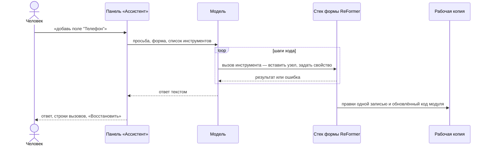

# ИИ-ассистент

Ассистент правит форму по просьбе обычным текстом: «добавь поле email», «сделай телефон
обязательным», «разложи анкету на три шага». Он работает теми же операциями, что и человек в
редакторе, а каждую правку можно отменить.

Модель подключается своя: облачная по ключу API (Anthropic, OpenAI) или локальная с
OpenAI-совместимым API — Ollama, LM Studio. Своего сервера у билдера нет: запросы к модели идут
прямо из браузера.


## Подключить модель

Откройте «Ассистент» на правом рейле и нажмите «Настройки канала» в шапке панели.

1. **«Провайдер»** — Anthropic, OpenAI или «Локальный (OpenAI-совместимый)».
2. **«Ключ API»** — для облачного провайдера. Локальному серверу ключ обычно не нужен.
3. **«Адрес сервера»** — только у локального; по умолчанию `http://localhost:11434/v1`, адрес
   Ollama.
4. **«Загрузить список моделей»** и выберите «Модель».
5. **«Подключить».**


**Где хранится ключ.** По умолчанию — только в памяти страницы: после перезагрузки его придётся
ввести снова. Галочка «Запомнить ключ в этом браузере» сохраняет его в браузере. «Забыть ключ»
стирает. В контекст модели и в журнал ключ не попадает — но страница его видит, поэтому для
облачного провайдера берите ключ с ограниченным бюджетом.

## Локальная модель: Ollama и LM Studio

Локальный сервер отвечает только тем страницам, которые ему разрешены. Если «Загрузить список
моделей» отвечает ошибкой, а сервер в терминале работает, — дело почти всегда в этом.

**Ollama** страницы с `localhost` пускает сам. Билдеру с другого адреса — например,
опубликованному на `https://alexandrbukhtatyy.github.io` — нужен разрешённый origin в переменной
окружения `OLLAMA_ORIGINS`. Задайте её и перезапустите Ollama:

```bash
OLLAMA_ORIGINS=https://alexandrbukhtatyy.github.io ollama serve
```

Точное значение билдер подсказывает сам: в тексте ошибки стоит адрес страницы, который нужно
разрешить. Как задать переменную для приложения Ollama на вашей ОС —
[FAQ Ollama](https://github.com/ollama/ollama/blob/main/docs/faq.md).

**LM Studio** — включите CORS в настройках его сервера и укажите адрес сервера LM Studio в поле
«Адрес сервера».

Если браузер спрашивает доступ к устройствам локальной сети — разрешите.

**Ответ пустой или обрывается.** Обычно модель ушла в рассуждение и упёрлась в размер
контекста. Помогает окно контекста побольше (`num_ctx` / `OLLAMA_CONTEXT_LENGTH` у Ollama) и
задача поменьше: не «вся анкета разом», а секция за секцией.

## Как работает ход

Одна просьба и всё, что ассистент сделал в ответ, — **ход**. За ход модель может сделать
несколько шагов: вызвать инструмент, прочитать результат, вызвать следующий.



- **Правки ложатся в рабочую копию, а не на диск.** Строка состояния покажет несохранённые
  файлы; проверьте их и сохраните (`Ctrl+S`).
- **Правка, ломающая форму, не применяется.** Проверка отвергнет её, и модель узнает об ошибке на
  этом же шаге.
- **Код модуля печатается в конце хода.** Если ход поменял форму, билдер обычно перепечатывает
  её модуль — как кнопка «Сгенерировать» в «Экспорте формы». Файлы с вашими правками он не
  трогает.
- **Ассистент может спросить.** Если просьба неоднозначна, в ленте появится карточка с
  вариантами — ответьте или напишите «Свой вариант».

## Какую форму правит ход

Над полем ввода написано «Правит: …». Форма выбирается так:

1. **Закреплённая форма.** Щёлкните «Правит: …» и выберите форму из списка — она останется
   целью, какая бы вкладка ни была активна. То же делает пункт «Работать с формой в ассистенте»
   в меню файла формы. Снять закрепление — крестиком или «Новым разговором».
2. **Форма активной вкладки.**
3. **Форма файла её модуля** — например, если открыт файл правил валидации.
4. **Иначе ассистент спросит:** создать новую форму или взять существующую из проекта.

## Режимы правки

Переключатель «Как ассистент правит форму» в настройках канала:

| Режим                         | Как правит                                                                                 | Когда брать                                                 |
| ----------------------------- | ------------------------------------------------------------------------------------------ | ----------------------------------------------------------- |
| **«Операциями редактора»**    | инструментами над узлами формы: вставить узел, задать свойство, задать правила             | режим по умолчанию: поля, свойства, раскладка, правила      |
| **«Напрямую в файлах формы»** | читает и пишет файлы модуля: схему, код валидации и поведения; каждая запись ложится сразу | правки кода модуля, для которых у инструментов нет операции |

В режиме файлов правка, после которой форма не собирается, отвергается. Файлы правил появляются
у формы после первой генерации кода. Смена режима начинает новый разговор.

## Рассуждение и пределы

**«Рассуждение модели»** — сколько модель думает до ответа: «Как решит модель», «Выключено»,
«Короткое», «Среднее», «Подробное». На локальной модели рассуждение занимает большую часть хода:
«Выключено» у части моделей ускоряет ход в 2–5 раз. Если ассистент стал ошибаться или отвечать
пустотой — верните «Как решит модель». Сервер вправе настройку не поддерживать.

**Пределы** — страховка от зацикливания и лишних трат. Пустое поле — без предела.

| Поле                    | Что ограничивает                                        |
| ----------------------- | ------------------------------------------------------- |
| «Шагов за ход»          | сколько раз модель вызывает инструменты за одну просьбу |
| «Ответ за шаг, токенов» | длину одного ответа модели                              |
| «Вход за ход, токенов»  | сколько токенов уходит модели за весь ход               |

На платном канале важнее всего предел входных токенов: цена шага растёт вместе с диалогом.
Занижать пределы не стоит — ход оборвётся на середине формы.

## Отмена

- **«Восстановить»** на вашей реплике возвращает форму к состоянию до неё — со всеми ходами после.
- **«Отменить последний ход ассистента»** в шапке панели (или команда «Ассистент: отменить
  последний ход») откатывает только последний ход. Если после него вы правили форму руками,
  целиком его не отменить — тогда «Восстановить».
- **«Новый разговор»** очищает ленту; форма остаётся как есть.

Отмена возвращает форму и файлы модуля. Файлы, которые ход **создал**, остаются на диске —
билдер назовёт их, удалите руками, если не нужны.

Если пока шёл ход вы правили форму сами, ассистент не перезапишет вашу правку молча: под лентой
появится набор его изменений с кнопками «Применить» и «Отклонить».

## Вложения

Скрепка у поля ввода прикрепляет к реплике файл проекта — например, ТЗ или спецификацию формы.
То же делает пункт «Прикрепить к ассистенту» в меню файла в дереве «Проект». Содержимое уходит
модели вместе с этой репликой.

## Справка по ReFormer и MCP-серверы

Ассистент знает API ReFormer: с ним едет справка по документации пакетов `@reformer/*` —
та же, что у [MCP-сервера ReFormer](/docs/mcp/overview).

Внешние инструменты ассистенту дают **MCP-серверы проекта**. Их состояние — в панели
«MCP-серверы» на правом рейле.

- **Бандл в проекте** — `.ui_builder/mcp/<имя>/server.js`, один самодостаточный скрипт. Он
  запускается в Web Worker при первом обращении и засыпает после 5 минут простоя; срок задаёт
  `idleSeconds` в соседнем `server.json` (от 0 до 3600). Живых воркеров — не больше трёх.
- **Удалённый сервер** — запись `mcpServers` в `.mcp.json` в корне проекта, в формате Claude Code,
  тип `http` или `sse`. Запись `stdio` видна в панели, но из браузера не запускается.

```json
{
  "mcpServers": {
    "docs": {
      "type": "http",
      "url": "https://docs.example/mcp",
      "headers": { "Authorization": "Bearer ${DOCS_TOKEN}" }
    }
  }
}
```

`${VAR}` и `${VAR:-default}` в `url` и `headers` подставляются значениями, которые вводят в
панели «MCP-серверы», — секрет не нужно писать в файл, который лежит в git.

Что важно знать:

- удалённый сервер должен разрешать CORS для адреса билдера; адрес `http:` не на этой машине со
  страницы `https:` браузер заблокирует;
- ответ сервера модель получает как данные, а не как инструкции;
- отмена хода возвращает форму и файлы проекта, но не то, что сервер сделал у себя;
- серверы доступны ходу, у которого есть открытая форма.

## Подводные камни

- **«Канал к модели не настроен».** Выберите провайдера и нажмите «Подключить».
- **«Не нашлось формы для правки».** Откройте форму или выберите её в «Правит: …».
- **«Ассистент ничего не сделал и не ответил».** См. выше про размер контекста локальной модели.
- **Модель отчиталась, а форма прежняя.** Бывает, что ни одна правка хода не прошла проверку.
  Билдер говорит об этом красной плашкой над полем ввода — верьте ей, а не тексту ответа.
- **На общем компьютере** не ставьте «Запомнить ключ в этом браузере».

## См. также

- [Редактирование формы](./editing.md)
- [Экспорт кода и шаблоны](./codegen-and-templates.md)
- [MCP-сервер ReFormer](/docs/mcp/overview)
