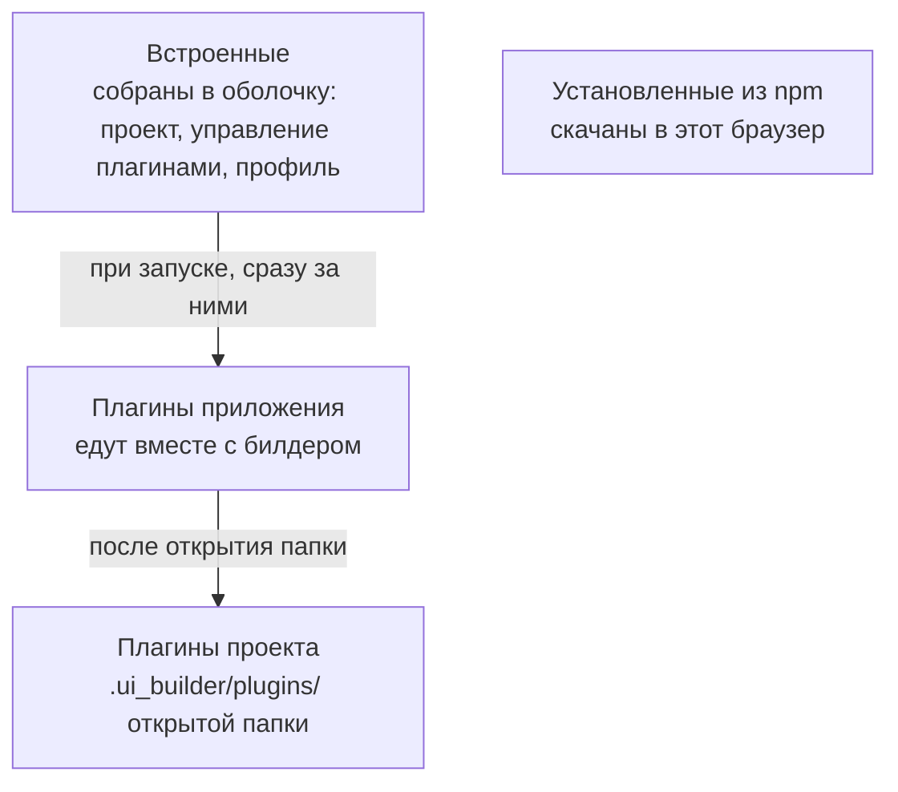

# Плагины: понятия

Билдер — оболочка: окно, открытие проекта, сохранение и управление плагинами. Всё остальное —
дерево файлов, редактор кода, редактор формы, превью, генерация кода, шаблоны, ассистент, киты —
приносят **плагины**. Свой плагин добавляет билдеру панель, команду, редактор файла нового
формата, кит компонентов или инструмент ассистенту.

## Что такое плагин

Плагин — каталог с манифестом и кодом:

```text
<id>/
├── manifest.json     кто он, что ему нужно, что он даёт
├── main.js           код; на время разработки можно main.ts — билдер транспилирует его сам
├── locales/ru.json   словарь строк, по файлу на язык — необязательно
├── styles.css        свои стили — необязательно
└── chunks/*.js       отложенный код и данные — необязательно
```

Код плагина — одна функция `activate`, в которой плагин **регистрирует** свои вклады: команды,
панели, редакторы, службы.

```ts
import { definePlugin } from '@reformer/builder-plugin-api';

export default definePlugin({
  id: 'acme-forms',
  activate(ctx) {
    ctx.subscriptions.push(
      ctx.commands.register({ id: 'acme-forms.hello', titleKey: 'command.hello', run: () => true })
    );
  },
});
```

Типы и функции контракта даёт пакет `@reformer/builder-plugin-api`, собирает и проверяет плагин
командная строка `reformer-plugin` из `@reformer/builder-plugin-cli`. С чего начать — страница
[Первый плагин](./first-plugin.md).

## Откуда берутся плагины



| Слой           | Откуда                                                        | Кто включает                  | Когда работает                            |
| -------------- | ------------------------------------------------------------- | ----------------------------- | ----------------------------------------- |
| встроенные     | собраны в оболочку                                            | профиль состава               | всегда                                    |
| **приложения** | каталог `plugins/` рядом со сборкой билдера, флаг `--plugins` | тот, кто развернул билдер     | всегда, в любом проекте; выключить нельзя |
| **проекта**    | `.ui_builder/plugins/` открытой папки                         | человек, в настройках проекта | пока открыт проект                        |
| **из npm**     | скачаны командой «Плагины: установить из npm…»                | человек                       | после включения                           |

Опубликованный билдер везёт как плагины приложения четыре домена — основу, платформу форм и два
движка форм:

| Домен      | Что приносит                                                                                                              |
| ---------- | ------------------------------------------------------------------------------------------------------------------------- |
| `base`     | «Файлы» — дерево проекта, «Журнал», «Редактор кода», «Markdown»                                                           |
| `forms`    | «Киты», «Предпросмотр», «Ассистент», «MCP-серверы», «Генерация кода», «Шаблоны» — общее для всех движков                  |
| `reformer` | «Редактор формы», «Предпросмотр формы ReFormer», «Проверка схемы» и стек ReFormer в генерации кода, шаблонах и ассистенте |
| `rjsf`     | «RJSF: редактор формы», «RJSF: превью формы в ките»                                                                       |

Плагин проекта с тем же идентификатором, что у плагина приложения, не грузится: работает
экземпляр приложения, а строка в списке помечена «перекрывает копию из проекта».

## Где лежат плагины

Каталог `.ui_builder/plugins/` допускает один уровень вложенности:

- **подкаталог с `manifest.json`** — плагин. Его имя обязано совпадать с `id` в манифесте;
- **подкаталог без `manifest.json` и без `package.json`** — **домен**: группа плагинов. Плагины —
  его подкаталоги с манифестом, имя каталога здесь с `id` не сверяется. Прочее в домене —
  например, общий код `core/` — билдер не трогает.

```text
.ui_builder/plugins/
├── acme-forms/           плагин acme-forms
└── acme/                 домен
    ├── editor/           плагин — id из его манифеста
    ├── render/           плагин
    └── core/             общий код домена, не плагин
```

Каталоги, чьё имя начинается с точки, билдер пропускает.

## Включение и доверие

Плагин исполняется в том же окне, что и билдер, — песочницы нет. Поэтому код из проекта сам не
запускается:

- **найденный плагин проекта появляется в списке выключенным**: включает его человек — в
  «Настройки» → «Плагины» или командой палитры «Плагины: включить «…»»;
- **список включённых виден всегда** и отзывается одним щелчком;
- **разрешение принадлежит проекту**: включённое в одной папке в другой не включается.


На вкладках раздела: «Установленные» — все плагины, «Каталог» — что предлагает поставить каталог
организации (`marketplace.registry` в [конфиге](../configuration.md)), «Обновления» — проверка
новых версий установленных из npm, «В разработке» — плагины в режиме разработки.

## Права

Права — не декларация намерений, а ключ к службе, которую оболочка отдаёт не всем. Прав три:

| Право                 | Что открывает                                                                              |
| --------------------- | ------------------------------------------------------------------------------------------ |
| `workspace.save`      | сохранять в проект — записывать написанное на диск                                         |
| `workspace.resources` | создавать, переименовывать, переносить, удалять и копировать файлы, открывать другую папку |
| `plugins.manage`      | включать, выключать, перезагружать и ставить другие плагины                                |

Права, которые просит манифест, человек подтверждает при включении плагина: «Плагин … просит
права». Без подтверждения плагин не включится, а подтверждение запишется в
`.ui_builder/settings.json`. Плагину без права нужная служба просто не видна.

## Возможности: как плагины находят друг друга

Плагины не импортируют друг друга. Один **даёт возможность** — службу с именем и версией, —
другой её **просит**. Так редактор формы получает активный кит, не зная, какой плагин его дал.

```json
{
  "provides": [{ "id": "acme.forms", "version": "1.2.0" }],
  "requires": {
    "required": [{ "id": "reformer.kit.catalog", "range": "^2" }],
    "optional": [{ "id": "acme.telemetry", "range": ">=0.2.0" }]
  }
}
```

- **`required`** проверяется до загрузки кода: нет возможности нужной версии — плагин не
  включается, а список плагинов называет, чего не хватает и что есть на самом деле.
- **`optional`** включению не мешает: плагин работает и без неё, спрашивая возможность в момент
  использования.
- **`provides`** — обещание. Не зарегистрировал обещанное в `activate` — плагин помечается
  упавшим.

Подробности контракта — [Манифест и API плагина](./manifest-and-api.md).

## Когда плагин падает

Плагин, бросивший исключение при включении, выключается, а причина остаётся в списке плагинов и
в «Журнале». Сам он не поднимается: включить его снова — осознанное действие, «Включить «…» ещё
раз». Исключение — плагин в режиме разработки: он поднимается сам после правки своих файлов.

## См. также

- [Первый плагин](./first-plugin.md)
- [Манифест и API плагина](./manifest-and-api.md)
- [Сборка и стили плагина](./build-and-styles.md)
