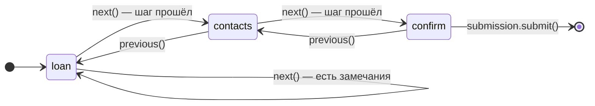

import { ComponentDoc } from '@site/src/components/demo';
import { formWizardDocConfig } from '@site/src/components/demo/examples/cdk-form-wizard';

# FormWizard

`FormWizard` рисует многошаговую форму: показывает текущий шаг, индикатор и прогресс, ведёт
кнопки «Назад», «Далее» и «Отправить». Разметку каждой части вы пишете сами.

Шаги и их правила визард не хранит. Это [поток шагов](../reference/glossary.md#поведение-шаги-и-отправка)
сборки формы: `createForm({ flow: { steps: [{ id, rules }] } })`. Визард рисует поток и зовёт его
переходы. Как устроены многошаговые формы целиком — в руководстве
[Многошаговые формы](/docs/guides/multi-step-forms).

## Когда использовать

- Длинную анкету нужно разбить на шаги, и «Далее» не должна пускать дальше, пока шаг заполнен с
  ошибками.
- Индикатор шагов, прогресс и кнопки нужны в своём дизайне.

Готовый визард с индикатором, прогрессом и кнопками — [FormWizard из ui-kit](../ui-kit/form-navigation.mdx).
Его же рисует рендерер, когда шаги описаны в схеме.

## Анатомия

| Часть                  | Что делает                                                                                                       |
| ---------------------- | ---------------------------------------------------------------------------------------------------------------- |
| `FormWizard`           | Корень: берёт поток и раздаёт состояние частям.                                                                  |
| `FormWizard.Step`      | Содержимое шага: `component` + `control` или `children`. N-й `Step` виден, когда поток на N-м шаге.              |
| `FormWizard.Indicator` | Индикатор шагов через функцию-ребёнка: шаги с `isCurrent`, `isCompleted`, `canNavigate` и переход `goToStep(n)`. |
| `FormWizard.Progress`  | Прогресс через функцию-ребёнка: `current`, `total`, `percent`.                                                   |
| `FormWizard.Actions`   | Кнопки: функция-ребёнок с `prev`, `next`, `submit` или готовые `Prev`, `Next`, `Submit` внутри.                  |

Число и порядок `FormWizard.Step` совпадают с шагами потока: шаги сопоставляются по позиции.
Номера шагов в частях визарда — с единицы.

```tsx
import { createForm } from '@reformer/core';
import { useFormBundle } from '@reformer/core/react';
import { FormWizard } from '@reformer/cdk/form-wizard';

// loanRules, contactsRules — defineValidation(...), константы модуля
function CreditWizard() {
  const bundle = useFormBundle(() =>
    createForm<CreditForm>({
      model: createCreditModel(),
      flow: {
        steps: [
          { id: 'loan', rules: loanRules },
          { id: 'contacts', rules: contactsRules },
          { id: 'confirm' }, // шаг без правил
        ],
      },
    })
  );

  return (
    <FormWizard form={bundle.form} flow={bundle.flow}>
      <FormWizard.Step component={LoanStep} control={bundle.form} />
      <FormWizard.Step component={ContactsStep} control={bundle.form} />
      <FormWizard.Step component={ConfirmStep} control={bundle.form} />

      <FormWizard.Actions
        onSubmit={async () => {
          await bundle.submission.submit(sendApplication);
        }}
      >
        <FormWizard.Prev>Назад</FormWizard.Prev>
        <FormWizard.Next>Далее</FormWizard.Next>
        <FormWizard.Submit loadingText="Отправка…">Отправить</FormWizard.Submit>
      </FormWizard.Actions>
    </FormWizard>
  );
}
```

### Как ходит поток

«Далее» зовёт `flow.next()`: поток проверяет правила текущего шага и переходит, только если
блокирующих замечаний нет. Проверенные поля шага помечаются тронутыми — ошибки становятся видны,
а поля следующих шагов остаются нетронутыми. Назад можно всегда; вперёд по индикатору — только на
пройденные шаги и на следующий за ними.



Возврат назад снимает отметку «пройден» с целевого шага и всех следующих: вперёд их снова
проверит `next()`.

### Откуда визард берёт поток

1. Проп `flow` — обычно `bundle.flow`.
2. Сборка в `FormBundleContext` из `@reformer/core/react`. Её ставит `FormRenderer`, а в своей
   разметке — `<FormBundleContext.Provider value={bundle}>`. Тогда `form` и `flow` пропами не нужны.
3. Ни того, ни другого — поток по числу `FormWizard.Step` **без правил**: переходы работают, но шаги
   не проверяются.

### Отправка

Отправка — `bundle.submission.submit(handler)`: одна проверка полного набора правил (правила всех
шагов плюс `validation.extras`), при успехе — обработчик со значениями модели.

- **Сборка в контексте** — кнопка «Отправить» визарда сама идёт через `bundle.submission` и зовёт
  `onSubmit` у `Actions` только после успешной проверки.
- **Поток пропом `flow`** — `onSubmit` зовётся по нажатию, проверку делает ваш обработчик:
  `bundle.submission.submit(sendApplication)`, как в примере выше. Возвращайте из `onSubmit`
  промис — тогда флаг `isSubmitting` держится всю отправку.

### Управление снаружи

`ref` у визарда нет. Код вне визарда работает с тем же потоком: `bundle.flow.next()`,
`previous()`, `goTo(id)`, `canGoTo(id)`, `reset()`. Перерисовку при смене шага даёт
`useFormFlow(bundle.flow)` из `@reformer/core/react`. Внутри визарда то же доступно хуком
`useFormWizard()`: `goToNextStep()`, `goToPreviousStep()`, `goToStep(n)`, `submit(handler)`.

Переходы снаружи не вызывают `onStepChange` и не прокручивают страницу — это визард делает только
для своих кнопок.

По умолчанию правила шага проверяются на «Далее», а вся форма — при отправке. Проверку при вводе
включает стратегия сборки — `createForm({ validation: { strategy: 'blur' } })`, см.
[Стратегии валидации](../validation/validation-strategies.md).

## Примеры

<ComponentDoc config={formWizardDocConfig} />

## Доступность

- При смене шага визард объявляет скринридеру «Шаг N из M» через скрытый регион
  `role="status"` с `aria-live="polite"`.
- Фокус после перехода визард не переносит. Переведите его на заголовок шага в `onStepChange`.
- `scrollToTop` (по умолчанию `true`) прокручивает страницу к началу после переходов визарда.
  Выключите его, если визард стоит не в начале страницы.
- `Prev` и `Next` — `<button type="button">`, `Submit` — `<button type="submit">`. Если визард стоит
  внутри своего `<form>`, отмените нативную отправку в его `onSubmit` (`event.preventDefault()`).
- Готовые кнопки отключаются сами: «Назад» — на первом шаге, «Далее» — на последнем, «Отправить» —
  до последнего, все три — пока идёт проверка или отправка. Атрибуты `data-first-step`,
  `data-last-step`, `data-not-last-step`, `data-submitting` помогают спрятать лишнюю кнопку стилями.
- `aria-current="step"` у индикатора ставите вы — флаг `isCurrent` приходит в функцию-ребёнка.

## Локализация

Видимый текст — подписи шагов и кнопок — ваш. Сам визард произносит одну строку: статус
«Шаг N из M» для скринридера, ключ `cdk.formWizard.stepStatus` с параметрами `current` и
`total`. Язык задаёт `I18nProvider` из `@reformer/core/react`; как подключить строки cdk — на
странице [Локализация](./locale.md). Тексты замечаний полей шага — [Тексты замечаний](./validation-messages.mdx).

## См. также

- [Многошаговые формы](/docs/guides/multi-step-forms) — поток шагов, правила и отправка целиком.
- [FormWizard в ui-kit](../ui-kit/form-navigation.mdx) — готовый визард.
- [Стратегии валидации](../validation/validation-strategies.md) — проверка при вводе.
