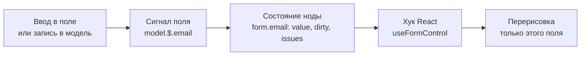

# Реактивность и сигналы

ReFormer хранит каждое значение формы в [сигнале](/docs/reference/glossary) — ячейке, на изменения
которой можно подписаться. Поэтому при вводе в поле перерисовывается только компонент этого поля, а
не вся форма.

## Когда нужно

Обычно сигналы не видны: хуки React и операторы поведения подписываются на них сами. Знать, как
они устроены, полезно, когда вы:

- читаете значения вне React — в тесте, в обработчике, в своей подписке;
- выясняете, почему компонент не перерисовался или перерисовался лишний раз;
- пишете своё поведение или свой компонент поля.

## Как изменение доходит до экрана



1. Значение записывается в сигнал поля [модели](./model.mdx) — из компонента, из поведения или
   вашим кодом.
2. [Нода формы](./nodes.md) пересчитывает своё состояние: значение, признак «изменено», замечания.
3. Хук React, который читает эту ноду, сообщает React о новом снимке.
4. React перерисовывает компонент, где вызван хук. Соседние поля не трогаются.

## Минимальный пример

```typescript
import { createModel } from '@reformer/core';
import { effect } from '@reformer/core/signals';

const model = createModel<{ name: string }>({ name: '' });

// Эффект подписывается на всё, что прочитал, и запускается снова при изменении.
const stop = effect(() => {
  console.log('Имя:', model.name);
}); // сразу выводит: Имя:

model.name = 'Анна'; // выводит: Имя: Анна
stop(); // отписаться
```

## Сигнал

Сигнал — значение с подпиской. Прочитали его внутри реактивного кода (`effect`, `computed`,
операторы поведения) — подписались. Записали — подписчики пересчитались.

```typescript
import { signal, computed, effect } from '@reformer/core/signals';

const count = signal(0);
const double = computed(() => count.value * 2); // пересчитывается, когда меняется count

effect(() => console.log(count.value, double.value)); // 0 0
count.value = 5; // 5 10
```

## Сигналы в форме

- **Значения** — сигналы модели. Сигнал поля — `model.$.email`; запись `model.email` читает и
  пишет тот же сигнал. См. [Модель данных](./model.mdx).
- **Состояние поля** — сигналы ноды: `value`, `valid`, `invalid`, `issues`, `touched`, `dirty`,
  `disabled`, `pending`. Форма вычисляет их поверх сигналов модели. См. [Ноды формы](./nodes.md).

## В React

В компонентах подписывайтесь хуками из `@reformer/core/react`, а не `effect`:

```tsx
import type { FormControl } from '@reformer/core';
import { useFormControl, useFormControlValue } from '@reformer/core/react';

// Состояние поля целиком: перерисовка при изменении любого его сигнала.
function NameHint({ control }: { control: FormControl<string> }) {
  const { value, shouldShowIssues } = useFormControl(control);
  return shouldShowIssues ? <span>Проверьте имя «{value}»</span> : null;
}

// Только значение: перерисовка лишь при изменении значения.
function Greeting({ control }: { control: FormControl<string> }) {
  const name = useFormControlValue(control);
  return <span>Привет, {name}</span>;
}
```

Все хуки — в разделе [React-хуки](/docs/react/hooks).

## Подводные камни

- **Один экземпляр рантайма.** `signal`, `computed`, `effect`, `batch` берите из
  `@reformer/core/signals`, а не из `@preact/signals-core` напрямую. Иначе в приложении окажутся две
  копии рантайма, и подписки между пакетами `@reformer/*` перестанут срабатывать.
- **`model.get()` не подписывает.** Это снимок для отправки. В `effect` или `computed` читайте поля
  по отдельности: `model.name`, `model.$.name.value`.
- **`peek()` читает без подписки.** Нужен там, где подписка лишняя: в обработчике события, в
  записи по текущему значению.

## См. также

- [Модель данных](./model.mdx) — где живут значения и как их читать и писать.
- [Ноды формы](./nodes.md) — состояние полей поверх модели.
- [React-хуки](/docs/react/hooks) — `useFormControl`, `useFormControlValue`, `useArrayLength`.
- [Глоссарий](/docs/reference/glossary) — модель, нода, сигнал поля.
