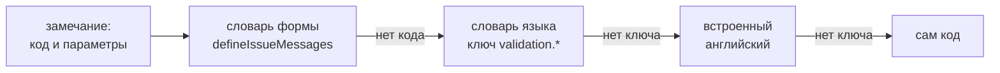

import LanguageSwitch from '@site/src/components/demo/live/guides/language-switch';
import languageSwitchSource from '@site/src/components/demo/live/guides/language-switch.tsx?raw';

# Локализация

Без настроек пакеты ReFormer говорят по-английски. Язык задаёт провайдер `I18nProvider`: он
загружает словари нужного языка, и подписи компонентов и тексты
[замечаний](../reference/glossary.md#валидация) переключаются на лету. Форма при этом не
пересоздаётся, введённые значения остаются.

## Когда нужно

- Интерфейс формы на русском или другом языке, а не на английском.
- Переключатель языка в приложении.
- Свои тексты замечаний для своих правил.
- Форма из JSON-документа, у которой подписи берутся по ключам словаря.

## Минимальный пример

Форма регистрации с переключателем языка. Внутри примера стоит свой `I18nProvider`: его язык
выбирает переключатель, а не язык страницы.

<LiveExample
  component={LanguageSwitch}
  source={languageSwitchSource}
  caption="Что попробовать: нажмите «Создать аккаунт» с пустыми полями, затем переключите EN — замечания и подписи переведутся, введённое останется."
/>

В примере три части:

1. **Загрузчик словарей** — `createLocaleLoader([...источники])`. Константа модуля: в нём кэш
   загруженных языков.
2. **Провайдер** — `<I18nProvider lang={lang} load={loadLocale}>`. Смена `lang` загружает другой
   язык; до конца загрузки на экране остаётся прежний.
3. **Тексты** — замечания правил и строки кита переводят словари библиотеки, тексты приложения —
   `useI18n().t(ключ)`.

## Словари ядра, cdk и кита

Каждый пакет поставляет свою локаль: английскую и русскую. Локаль накопительная: словарь кита уже
включает словари ядра и cdk. Поэтому в загрузчик ставят один источник встроенных словарей — от
самого верхнего пакета, который использует приложение.

| Пакеты приложения              | Источник                                     | Что в словаре                           |
| ------------------------------ | -------------------------------------------- | --------------------------------------- |
| только ядро                    | `loadCoreLocale` из `@reformer/core/locale`  | тексты замечаний, единицы размера файла |
| ядро и `@reformer/cdk`         | `loadCdkLocale` из `@reformer/cdk/locale`    | то же и строки cdk (`cdk.*`)            |
| ядро, cdk и `@reformer/ui-kit` | `loadKitLocale` из `@reformer/ui-kit/locale` | то же и подписи кита (`kit.*`)          |

Свои тексты и правки встроенных — следующими источниками:

```typescript
import { createLocaleLoader, fetchMessages } from '@reformer/core/i18n';
import { loadKitLocale } from '@reformer/ui-kit/locale';

export const loadLocale = createLocaleLoader([
  loadKitLocale, // ядро + cdk + кит: чанк нужного языка по запросу
  fetchMessages((code) => `/locales/${code}.json`), // тексты приложения — с сервера
]);
```

- Источник — функция `(code) => локаль | словарь | null`. Она может вернуть локаль целиком
  (`{ code, messages, … }`) или просто словарь `{ "ключ": "текст" }`. `null` значит «для этого
  языка ничего нет» и ошибкой не считается.
- Источники опрашиваются параллельно, а сливаются по порядку: поздний перекрывает ранний.
- Загруженный язык кэшируется, повторный запрос не уходит.
- Отказ любого источника — отказ загрузки. Источник, который может промахнуться, оборачивайте:
  `(code) => source(code).catch(() => null)`.

Встроенный словарь бывает в трёх видах: загрузчик (`loadKitLocale`), JSON-файл
(`@reformer/ui-kit/locale/ru.json` — можно выложить на свой сервер) и синхронный модуль
(`ru` из `@reformer/ui-kit/locale/ru` — для серверного рендера и тестов). Те же три вида есть у
ядра и cdk.

## Провайдер

```tsx
import { I18nProvider } from '@reformer/core/react';

function App() {
  const [lang, setLang] = useState('ru');
  return (
    <I18nProvider lang={lang} load={loadLocale} fallback={<p>Загрузка…</p>}>
      <LangPicker value={lang} onChange={setLang} />
      <CreditForm />
    </I18nProvider>
  );
}
```

| Проп            | Назначение                                                              |
| --------------- | ----------------------------------------------------------------------- |
| `lang` + `load` | провайдер загружает язык сам; `load` — константа модуля                 |
| `fallback`      | что показать, пока не загружен самый первый язык; по умолчанию — ничего |
| `onError`       | отказ загрузки: `(error, lang) => …`                                    |
| `locale`        | готовая локаль вместо `lang` + `load` — для серверного рендера и тестов |

- При смене `lang` на экране остаётся прежний язык, пока новый не загрузится. Для индикатора —
  `useI18n().pending`. При быстром переключении применяется только последний выбор.
- Ошибка загрузки язык не меняет: она попадает в `useI18n().error` и `onError`, повторить —
  `useI18n().retry()`. Если упала самая первая загрузка, форма показывается на английском.
- Вложенный провайдер заменяет язык для своего поддерева. Так устроен пример выше.
- При серверном рендере эффекты не выполняются — передавайте готовую локаль:
  `<I18nProvider locale={ru}>`.

## Тексты приложения

`useI18n()` из `@reformer/core/react` переводит ключи приложения и форматирует числа и даты по
правилам языка:

```tsx
import { useI18n } from '@reformer/core/react';

function CartSummary({ count, total }: { count: number; total: number }) {
  const { t, number } = useI18n();
  return (
    <p>
      {t('cart.items', { count })}: {number(total, { style: 'currency', currency: 'RUB' })}
    </p>
  );
}
```

Сообщения пишутся в подмножестве формата ICU:

| Что             | Пример                                                                    |
| --------------- | ------------------------------------------------------------------------- |
| подстановка     | `Открыт файл {name}`                                                      |
| формы числа     | `{count, plural, one{# файл} few{# файла} many{# файлов} other{# файла}}` |
| точное значение | `{count, plural, =0{файлов нет} other{# файлов}}`                         |
| выбор           | `{gender, select, male{он} female{она} other{оно}}`                       |

Ветка `other` обязательна. Типов `number` и `date` внутри сообщения нет: число или дату
отформатируйте через `number()` / `date()` и передайте готовой строкой.

Ключа нет в словаре — `t` вернёт третий аргумент (текст по умолчанию), а без него — сам ключ.
Форма при этом не падает: неполный словарь с сервера — нормальный случай.

## Подписи полей

Подпись поля — строка в `componentProps` узла схемы. Компонент поля показывает её как есть. Чтобы
подпись менялась вместе с языком, положите перевод в пропсы при смене языка — так делает пример
выше:

```tsx
const { t } = useI18n();

useEffect(() => {
  form.email.updateComponentProps({ label: t('signup.email') });
}, [form, t]);
```

## Тексты замечаний

Замечание несёт код и параметры, а текста в нём нет. Текст подбирается в момент показа, поэтому
смена языка переводит уже показанные замечания без повторной проверки.



Встроенные правила (`required`, `email`, `minLength` и другие) переведены в словаре ядра. Своему
правилу дайте свой код, а текст кода — в словарь формы:

```tsx
import { defineIssueMessages } from '@reformer/core/i18n';
import { validate } from '@reformer/core/validation';
import { min, required } from '@reformer/core/validators';
import { ValidationMessagesProvider } from '@reformer/cdk';

// в схеме правил: код вида «поле.правило»
validate(model.$.loanAmount, [
  required({ code: 'loanAmount.required' }),
  min(50_000, { code: 'loanAmount.min' }),
]);

// словарь формы — константа модуля
export const loanMessages = defineIssueMessages({
  'loanAmount.required': 'Укажите сумму кредита',
  // число с разрядами — функцией: шаблон печатает 50000 без пробелов
  'loanAmount.min': (params, i18n) => `Минимум ${i18n.number(Number(params.min))} ₽`,
});

// словарь подключается один раз на корне формы; FormField читает его сам
<ValidationMessagesProvider messages={loanMessages}>
  <LoanForm />
</ValidationMessagesProvider>;
```

- **Свой код без записи в словаре** покажет на экране сам код (`loanAmount.required`). Каждому
  своему коду — запись в словаре формы.
- **Текст на разных языках.** Запись словаря может быть функцией и взять текст из словаря языка:
  `(_params, i18n) => i18n.t('loan.amountRequired')`. Другой путь — ключ
  `validation.loanAmount.required` в словаре приложения: он переключается вместе с языком.
- **Свой текст встроенного правила** — тот же ключ в словаре приложения:
  `{ "validation.required": "Заполните поле" }`.
- **Свой компонент замечаний** получает текст через `useIssueMessage(loanMessages)` из
  `@reformer/core/react`; вне React — `resolveIssueMessage(issue, createI18n(ru), loanMessages)` из
  `@reformer/core/i18n`.

Коды и параметры встроенных правил — в разделе [Валидация](/docs/validation/overview).

## Форма из JSON — `$locale`

В JSON-документе подпись задают ключом: `"label": "$locale(fields.email.label)"`. Ключи переводит
сервис локализации из реестра документа (`reg.locale(...)`), а не `I18nProvider`. Такая строка
переводится один раз — когда сборка строит дерево из документа. Смена языка — это новый сервис и
пересборка формы; живое переключение даёт компонент `$component(I18n)` с `LocaleProvider`.
Подробности — в разделе [@reformer/renderer-json](/docs/packages/renderer-json).

Тексты замечаний JSON-формы рисует тот же `FormField`, поэтому их язык задаёт `I18nProvider`, как и
в любой другой форме.

## Проверка словаря в тестах

`validateLocale(словарь, образец)` из `@reformer/core/i18n` сравнивает переводы с образцом и
возвращает список проблем. На вход — плоские словари `{ "ключ": "текст" }`:

```typescript
import { validateLocale } from '@reformer/core/i18n';
import en from './locales/en.json'; // тексты приложения
import ru from './locales/ru.json';

expect(validateLocale(ru, en)).toEqual([]);
// находит: сообщение не разбирается, ключа не хватает или он лишний, потеряна подстановка
```

## Подводные камни

- **`I18nProvider` из `@reformer/core`** — там его нет. Провайдер и хуки — из
  `@reformer/core/react`, загрузчик и словари — из `@reformer/core/i18n`.
- **Загрузчик внутри компонента** — `load={createLocaleLoader([...])}` создаёт новый кэш на каждый
  рендер, и язык загружается заново. Держите загрузчик константой модуля.
- **Текст в правиле** — `required({ message: '…' })` не скомпилируется: у правил нет текста. Свой
  код и запись в словаре формы.
- **Словарь формы внутри компонента** — новый объект на каждый рендер пересоздаёт резолвер.
  `defineIssueMessages(...)` — константа модуля.
- **Настройки локали без словаря** — источник, вернувший `{ weekStartsOn: 1 }`, принимается за
  словарь. Отдавайте поле `messages`, хотя бы пустым: `{ weekStartsOn: 1, messages: {} }`.
- **Описатели `msg(...)` в пропсах схемы** — компоненты полей их не раскрывают и получат объект
  вместо строки. Подпись кладите строкой.

## См. также

- [Глоссарий](../reference/glossary.md) — замечание, словарь сообщений, сборка формы
- [Валидация](/docs/validation/overview) — правила и их коды
- [@reformer/renderer-json](/docs/packages/renderer-json) — `$locale` и сервис локализации
- [Многошаговые формы](./multi-step-forms.mdx) — подписи кнопок мастера тоже из словаря кита
