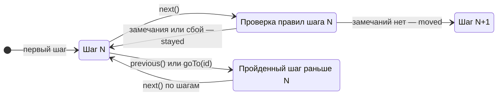

import TicketWizard from '@site/src/components/demo/live/guides/ticket-wizard';
import ticketWizardSource from '@site/src/components/demo/live/guides/ticket-wizard.tsx?raw';

# Многошаговые формы

Многошаговая форма — одна форма, поля которой разложены по шагам. Кнопка «Далее» проверяет только
правила текущего шага и не пускает дальше, пока на шаге есть ошибки. Порядок шагов и их правила
описывает [поток шагов](../reference/glossary.md#поведение-шаги-и-отправка) — поле `flow` в
`createForm`.

## Когда нужно

- Длинная форма — заявка, анкета, оформление заказа, — которую удобнее заполнять частями.
- Ошибки нужно показывать по шагам, а не всей формы сразу.
- Нельзя перепрыгнуть вперёд, не заполнив предыдущие шаги.

## Минимальный пример

Мастер на три шага из `@reformer/ui-kit`. Шаги и их правила — в `flow` сборки, мастер рисует
индикатор, тело текущего шага и кнопки.

<LiveExample
  component={TicketWizard}
  source={ticketWizardSource}
  caption="Что попробовать: нажмите «Далее» на пустом шаге — ошибки только у полей этого шага. Укажите 7 мест — шаг «Билет» не пропустит. Кликните по шагу в индикаторе, чтобы вернуться назад."
/>

## Поток шагов

Шаги объявляются один раз — в `flow.steps` сборки. У шага идентификатор и правила:

```typescript
import { createForm } from '@reformer/core';

const createLoanForm = () =>
  createForm<LoanForm>({
    initial,
    schema: loanSchema,
    validation: { extras: crossStepRules }, // правила вне шагов — только при отправке
    flow: {
      steps: [
        { id: 'loan', rules: loanRules },
        { id: 'applicant', rules: applicantRules },
        { id: 'confirm' }, // шаг без правил
      ],
    },
  });
```

- **Правила шага** — обычная схема `defineValidation` из `@reformer/core/validation`, константа
  модуля. Шаг без `rules` проходится без проверки.
- **Правила вне шагов** — `validation.extras`: например, правило, которое сравнивает поля разных
  шагов. Они проверяются только при проверке всей формы.
- **Полный набор** — правила всех шагов и `extras`. Его проверяют `bundle.validate()` и отправка
  `bundle.submission.submit(handler)`.
- **Идентификатор шага** — строка. Если мастер рисует [рендерер по схеме](#мастер-в-схеме-формы),
  это `selector` узла шага.
- Повтор идентификатора — исключение при сборке.

Сборка отдаёт поток в `bundle.flow` (без `flow` в конфиге там `undefined`):

| Член потока               | Что это                                          |
| ------------------------- | ------------------------------------------------ |
| `steps`                   | идентификаторы шагов по порядку                  |
| `current`, `index`        | сигналы текущего шага и его номера с нуля        |
| `completed`               | сигнал пройденных шагов                          |
| `isFirst`, `isLast`       | сигналы крайних шагов                            |
| `validating`              | идёт проверка шага в `next()`                    |
| `next()`                  | проверить правила текущего шага и перейти дальше |
| `previous()`              | шаг назад                                        |
| `goTo(id)`, `canGoTo(id)` | перейти на шаг; доступен ли шаг                  |
| `reset()`                 | вернуться на первый шаг и забыть пройденные      |

## Машина шагов



- **Вперёд — только `next()`.** Он проверяет правила текущего шага, при успехе отмечает шаг
  пройденным и переходит. При замечаниях поток остаётся на шаге, а поля шага помечаются тронутыми —
  ошибки становятся видны.
- **Назад — всегда.** `previous()` и `goTo(id)` на более ранний шаг. Пройденными остаются только
  шаги до цели: вперёд их снова проходят через `next()`.
- **`goTo(id)` вперёд** пускает только на шаг, предыдущий которого пройден (`canGoTo(id)`). Первый
  шаг доступен всегда. Неизвестный `id` — исключение.

Переходы возвращают результат, а не `boolean`: `{ status: 'moved', from, to }` либо
`{ status: 'stayed', step, reason, validation? }`. Причина остаться на шаге:

| `reason`    | Когда                                                                                                                 |
| ----------- | --------------------------------------------------------------------------------------------------------------------- |
| `invalid`   | у шага есть блокирующие замечания                                                                                     |
| `error`     | правило не вернуло результат — например, упал запрос async-правила                                                    |
| `cancelled` | проверка устарела: пока она шла, поток перевели или сбросили либо поле изменилось. Шаг не пройден, повторите `next()` |
| `edge`      | дальше (или раньше) шагов нет: `next()` на последнем шаге — шаг при этом отмечается пройденным                        |
| `locked`    | `goTo(id)` на шаг, предыдущий которого ещё не пройден                                                                 |
| `current`   | `goTo(id)` на шаг, где поток уже стоит                                                                                |

```typescript
const transition = await bundle.flow!.next();
if (transition.status === 'moved') track(transition.to);
else if (transition.reason === 'error') showToast('Не удалось проверить шаг, повторите');
```

## Проверка и отправка

| Вызов                               | Какие правила             | Что с полями                                            |
| ----------------------------------- | ------------------------- | ------------------------------------------------------- |
| `flow.next()`                       | текущего шага             | поля шага тронуты; при успехе — переход                 |
| `bundle.validateStep(id)`           | шага `id`                 | поля шага тронуты; перехода нет                         |
| `bundle.validate()`                 | полный набор              | проверенные поля тронуты                                |
| `bundle.submission.submit(handler)` | полный набор, один прогон | при ошибках тронута вся форма, обработчик не вызывается |

Отправка на последнем шаге проверяет всю форму сама: отдельно проверять последний шаг не нужно.
Поток отправка не трогает — при ошибке пользователь остаётся на последнем шаге. Подробно об
отправке — в [Отправке и сбросе](/docs/patterns/submit-and-reset).

По умолчанию проверка идёт только на «Далее» и на отправке. Живая проверка во время ввода —
стратегия сборки: `validation: { extras, strategy: 'blur' }`. Ошибки при этом видны только у полей,
которые трогали или меняли, поэтому поля следующих шагов раньше времени не подсвечиваются. См.
[Стратегии валидации](/docs/validation/validation-strategies).

## Чем рисовать шаги

Поток не знает про разметку. Нарисовать его можно тремя способами:

| Способ                                      | Когда брать                                                                                         |
| ------------------------------------------- | --------------------------------------------------------------------------------------------------- |
| `FormWizard` из `@reformer/ui-kit`          | готовый мастер: индикатор шагов, тело шага, кнопки и прогресс уже оформлены                         |
| `FormWizard` из `@reformer/cdk/form-wizard` | своё оформление: составные части без стилей (`FormWizard.Step`, `.Indicator`, `.Actions`, `.Next`…) |
| свои кнопки и `useFormFlow`                 | шаги не похожи на мастер — например, вкладки или одна страница с секциями                           |

Оба `FormWizard` — обёртки над потоком: «Далее» зовёт `flow.next()`, «Назад» — `flow.previous()`,
клик по индикатору — `flow.goTo(id)`. Поток мастер берёт из пропа `flow`, иначе из сборки в
контексте. Без того и другого он строит поток по числу шагов **без правил** — «Далее» тогда ничего
не проверяет.

### Мастер в разметке

Так устроен пример выше: `form`, `flow` и список шагов — пропсами.

```tsx
<FormWizard form={bundle.form} flow={bundle.flow} steps={STEPS} onSubmit={send} />
```

- `steps[i]` рисует шаг `flow.steps[i]`: записей столько же, сколько шагов потока.
- `onSubmit` в этом режиме зовётся по нажатию, без проверки. Проверку и отправку делает
  `bundle.submission.submit(handler)` внутри колбэка. Колбэк возвращает промис — пока он не
  выполнен, кнопка показывает «Отправка…».

### Мастер в схеме формы

Если форму рисует [рендерер](/docs/packages/renderer-react), мастер — обычный узел схемы, а шаги —
его дети. Идентификатор шага в потоке совпадает с `selector` узла шага:

```tsx
import type { FormModel, FormSchemaNode } from '@reformer/core';
import { defineFormBehavior, onComponentEvent } from '@reformer/core/behaviors';
import { Step } from '@reformer/cdk/form-wizard';
import { FormWizard, Input, InputNumber } from '@reformer/ui-kit';

const loanSchema = (model: FormModel<LoanForm>): FormSchemaNode => ({
  selector: 'wizard',
  component: FormWizard,
  componentProps: { submitLabel: 'Отправить заявку' },
  children: [
    {
      selector: 'loan', // id шага в flow.steps
      component: Step,
      componentProps: { title: 'Кредит' },
      children: [{ model: model.$.amount, component: InputNumber }],
    },
    {
      selector: 'applicant',
      component: Step,
      componentProps: { title: 'Заявитель' },
      children: [{ model: model.$.fullName, component: Input }],
    },
  ],
});

const loanBehavior = defineFormBehavior<LoanForm>(({ schema }) => {
  // Внутри сборки кнопка отправки идёт через submission.submit:
  // обработчик вызывается только после успешной проверки всей формы.
  onComponentEvent(schema.node('wizard'), 'onSubmit', (values: LoanForm) => api.send(values));
});
```

Мастер берёт форму и поток из сборки сам. Шаги рисуются в порядке `flow.steps`, а не в порядке
узлов. Если шаг потока и узел шага не совпали по идентификатору, в режиме разработки будет
предупреждение. Подробно — на странице [FormWizard (CDK)](/docs/cdk/form-wizard).

### Свои кнопки — `useFormFlow`

```tsx
import { useFormFlow } from '@reformer/core/react';

function StepButtons({ bundle }: { bundle: FormBundle<LoanForm> }) {
  const flow = bundle.flow!;
  const { current, isFirst, isLast, validating } = useFormFlow(flow);

  return (
    <div data-step={current}>
      {!isFirst && <button onClick={() => flow.previous()}>Назад</button>}
      {isLast ? (
        <button onClick={() => void bundle.submission.submit(sendLoan)}>Отправить</button>
      ) : (
        <button disabled={validating} onClick={() => void flow.next()}>
          Далее
        </button>
      )}
    </div>
  );
}
```

`useFormFlow` подписывает компонент на поток: он перерисуется при смене шага.

## Управление снаружи мастера

Поток — объект сборки, поэтому мастер для навигации не нужен:

```typescript
await bundle.flow?.next();
bundle.flow?.goTo('loan');
await bundle.validateStep('applicant'); // проверить шаг без перехода
```

В поведении формы поток приходит в область — например, чтобы вернуть пользователя на шаг при смене
условия:

```typescript
import { defineFormBehavior, renderEffect } from '@reformer/core/behaviors';

const navigation = defineFormBehavior<LoanForm>(({ model, schema, flow }) => {
  renderEffect(schema, () => {
    if (model.loanType === 'mortgage') flow?.goTo('loan');
  });
});
```

## Подводные камни

- **«Далее» ничего не проверяет.** Мастеру не передан `flow`, и он нарисован вне сборки — тогда он
  строит поток без правил. Либо у шага нет `rules`. Передайте `flow={bundle.flow}`.
- **Отправка вызывает обработчик без проверки.** Мастер в разметке зовёт `onSubmit` по нажатию.
  Отправляйте через `bundle.submission.submit(handler)`.
- **`goTo(id)` не переводит вперёд** — шаг закрыт (`locked`), пока не пройден предыдущий. Вперёд —
  `next()`.
- **Результат как `boolean`** — `if (await flow.next())` всегда истинно: результат — объект.
  Проверяйте `status`.
- **Номер шага вместо идентификатора** — `validateStep(1)` не скомпилируется. Шаг — строка из
  `flow.steps`.
- **Опечатка в идентификаторе шага** — `goTo('lon')` и `validateStep('lon')` бросают исключение.
  Если мастер рисует рендерер, расхождение шагов потока и узлов шагов в схеме видно по
  предупреждению в режиме разработки.

## См. также

- [FormWizard (CDK)](/docs/cdk/form-wizard) — составные части мастера без стилей
- [FormWizard (UI Kit)](/docs/ui-kit/form-navigation) — готовый мастер, варианты и пропсы
- [Стратегии валидации](/docs/validation/validation-strategies) — живая проверка шагов
- [Отправка и сброс](/docs/patterns/submit-and-reset) — статусы отправки и ответ сервера
