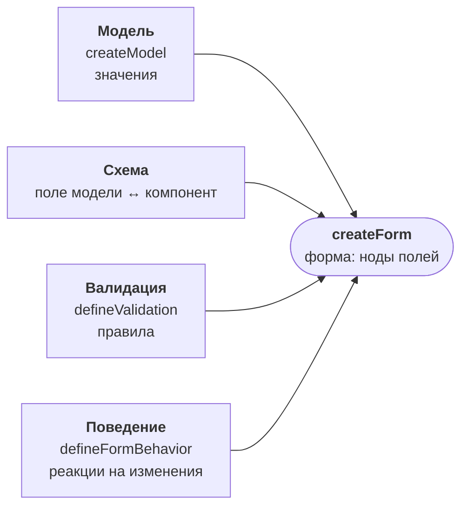

# Введение

**ReFormer** — библиотека для построения сложных форм на React, основанная на
[сигналах](https://github.com/preactjs/signals). Она даёт декларативный способ описывать формы с
валидацией, вычисляемыми полями и условной логикой — без ручной синхронизации состояния и лишних
перерисовок. Ядро от React не зависит: привязка к React — отдельный вход `@reformer/core/react`.

## Философия: архитектура M1

В основе ядра лежит архитектура **M1**, разделяющая форму на четыре слоя. Каждый слой отвечает за
одну задачу, что делает форму предсказуемой, переиспользуемой и легко тестируемой.

1. **Модель** (`createModel`) — источник истины для значений. Обычный на вид объект, где под каждым
   полем стоит реактивный сигнал. Значения принадлежат модели, а не UI.
2. **Схема** — дерево узлов: узел поля привязывает поле модели к компоненту
   (`{ model: model.$.field, component, componentProps }`), контейнер собирает узлы в `children`.
   Правил валидации в схеме нет — они живут отдельной схемой `defineValidation`.
3. **Форма** (`createForm`) — собирает всё одним вызовом: строит ноды (`FormControl` / `FormGroup` /
   `FormArray`) поверх сигналов модели, подключает правила валидации, поток шагов и поведение. К
   полям обращаются через типизированную группу: `form.email`, `form.address.city`.
4. **Behavior** (`defineFormBehavior`) — декларативная реактивная логика: вычисляемые поля, условная
   доступность, синхронизация, реакции на изменения.

Такое разделение — ключевая идея: **«какие данные собираем»** (модель + схема) отделено от
**«как данные реагируют»** (behavior) и от **«правильны ли данные»** (схема валидации).

## Ключевые возможности

- **Реактивность на сигналах** — точечные обновления без лишних ре-рендеров.
- **Типобезопасность** — полный вывод типов из формы; доступ к полям через типизированную группу
  `FormGroup`.
- **Декларативная валидация** — набор встроенных валидаторов-фабрик + произвольная кастомная логика;
  правило возвращает код замечания, а текст даёт словарь сообщений.
- **Декларативные behaviors** — вычисляемые поля, условная доступность, синхронизация полей.
- **Вложенность и массивы** — сложные структуры и динамические списки, принадлежащие модели.
- **Пошаговые формы** — поток шагов с правилами каждого шага прямо в сборке формы.
- **AI-friendly** — предсказуемый API с чёткими паттернами, удобный для генерации ассистентами.

## Экосистема

`@reformer/core` — фундамент. Поверх него:

<PackageMap />

| Пакет                                                       | Назначение                                              |
| ----------------------------------------------------------- | ------------------------------------------------------- |
| [`@reformer/core`](/docs/core-concepts/model)               | ядро: модель, схема, форма, поведение, валидаторы, хуки |
| [`@reformer/cdk`](/docs/cdk/overview)                       | headless-компоненты (FieldArray, FormWizard, FormField) |
| [`@reformer/ui-kit`](/docs/ui-kit/overview)                 | готовые стилизованные поля (Input, Select, Checkbox, …) |
| [`@reformer/renderer-react`](/docs/packages/renderer-react) | рендеринг формы по дереву схемы                         |
| [`@reformer/renderer-json`](/docs/packages/renderer-json)   | форма из JSON-описания                                  |
| [`@reformer/form-registry`](/docs/packages/form-registry)   | формы, которые приложение получает от микрофронтендов   |
| [`@reformer/mcp`](/docs/mcp/overview)                       | справочник и генерация форм для ИИ-ассистентов          |

## Что внутри @reformer/core

Пакет разбит на слои, у каждого свой вход:

| Слой             | Импорт                      | Назначение                                                                                                                     |
| ---------------- | --------------------------- | ------------------------------------------------------------------------------------------------------------------------------ |
| **Модель**       | `@reformer/core`            | `createModel`, `arrayOf` — источник истины значений; доступ к сигналам через `model.$.<field>`                                 |
| **Форма и ноды** | `@reformer/core`            | `createForm` — сборка одним вызовом; ноды `FormControl` / `FormGroup` / `FormArray`; доступ к полям через `form.<field>`       |
| **Валидация**    | `@reformer/core/validation` | схема `defineValidation` + операторы `validate`, `validateAsync`, `validateWhen`, `apply`, `applyEach`; раннер `validateModel` |
| **Валидаторы**   | `@reformer/core/validators` | чистые фабрики `required`, `email`, `min`, `max`, `minLength`, `pattern`, `phone`, `url`, числовые, датовые и файловые         |
| **Сообщения**    | `@reformer/core/i18n`       | словарь текстов замечаний `defineIssueMessages`, резолвер `resolveIssueMessage`, локали                                        |
| **Поведение**    | `@reformer/core/behaviors`  | декларативный DSL `defineFormBehavior` + операторы `compute`, `onChange`, `enableWhen`, `copyFrom`, …                          |
| **Сигналы**      | `@reformer/core/signals`    | единый реактивный рантайм (`signal`, `computed`, `effect`, `batch`) для интеграций                                             |

**React-часть** (`@reformer/core/react`): `useFormBundle` (стабильная сборка формы), `useFormControl`
(полное состояние поля), `useFormControlValue` (значение `T` напрямую), `useArrayLength` (реактивная
длина массива), `useFormFlow` (состояние потока шагов), `I18nProvider` и `useIssueMessage` (язык и
тексты замечаний).

## Дальше

- [Установка](/docs/getting-started/installation) — добавить ReFormer в проект.
- [Быстрый старт](/docs/getting-started/quick-start) — собрать первую форму.
- [Основные концепции](/docs/core-concepts/reactive-state) — как всё устроено внутри.
- [Примеры](/docs/examples) — готовые формы и демо-стенд.
- [Билдер](/docs/builder/overview) — собрать форму в визуальном редакторе и выгрузить её код.
- [Переход с прежних API](/docs/reference/migration) — если вы обновляетесь с прежней версии.
