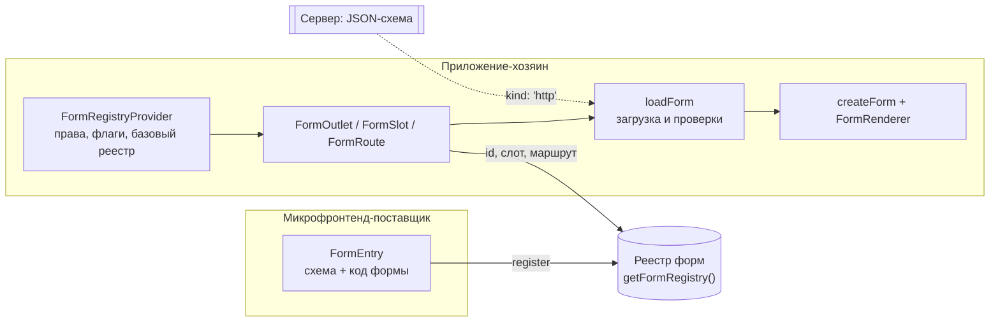

# @reformer/form-registry

`@reformer/form-registry` — реестр форм для приложения из нескольких микрофронтендов. Один бандл
регистрирует форму записью, другой показывает её по `id`, слоту или маршруту — с учётом прав
пользователя и фич-флагов. Связка «форма → место на странице» перестаёт быть ручной проводкой из
импорта, пункта меню и маршрута.

## Когда нужен

- Форму делает одна команда, а показывает приложение, которое собирается и выкладывается отдельно.
- Схема формы приходит по сети, а правила и поведение — в бандле микрофронтенда.
- Показ формы зависит от прав и флагов, и обойти проверку другим способом адресации нельзя.

**Когда не нужен.** Форма и страница живут в одном приложении. Тогда форму собирают напрямую:
`createForm` и `FormRenderer` — см. [@reformer/renderer-json](./renderer-json.mdx).

## Как это устроено



1. **Поставщик** описывает форму записью `FormEntry` и регистрирует её в общем реестре.
2. **Хозяин** ставит `FormRegistryProvider` с правами, флагами и общим реестром компонентов.
3. **Место монтирования** (`FormOutlet`, `FormSlot`, `FormRoute`) находит запись и отсеивает
   недоступные.
4. **Загрузчик** собирает части формы — схему, код, начальные значения — и проверяет их до сборки.
5. **Сборка** — обычные `createForm` и `FormRenderer`.

Реестр общий на всю страницу: два независимо собранных бандла видят одни и те же записи.

## Установка

```bash
npm install @reformer/form-registry @reformer/core @reformer/renderer-json @reformer/renderer-react
```

`react` нужен только входу `@reformer/form-registry/react`. Сам реестр, хранилище и проверки работают
и без React.

| Вход                               | Что внутри                                                    | React |
| ---------------------------------- | ------------------------------------------------------------- | ----- |
| `@reformer/form-registry`          | реестр, отбор форм, загрузчик, проверки, сеть, кэш            | нет   |
| `@reformer/form-registry/react`    | `FormRegistryProvider`, `FormOutlet`, `FormSlot`, `FormRoute` | да    |
| `@reformer/form-registry/storage`  | хранилища кэша: OPFS, IndexedDB, память; `pickStorage`        | нет   |
| `@reformer/form-registry/manifest` | проверка схемы мета-схемой; тянет ajv                         | нет   |
| `@reformer/form-registry/guard`    | поиск второй копии библиотеки на странице                     | нет   |

## Минимальный пример

Поставщик описывает форму:

```ts title="mfe-orders/checkout.entry.ts"
import type { FormEntry } from '@reformer/form-registry';

export const checkoutEntry: FormEntry<CheckoutForm> = {
  id: 'checkout',
  version: '1.0.0',
  owner: 'mfe-orders', // кто зарегистрировал: по нему разбираются совпадения id

  // Данные: документ формата 2 из бандла.
  schema: { kind: 'inline', value: checkoutSchema },
  initial: { kind: 'inline', value: { items: [], delivery: 'pickup' } },

  // Код: только из бандла.
  registry: { kind: 'inline', value: checkoutRegistry },
  behavior: { kind: 'inline', value: checkoutBehavior },
  validation: { kind: 'inline', value: checkoutRules },

  placement: { slots: ['order.sidebar'] },
  access: { permissions: ['orders.write'] },
};
```

…регистрирует её при монтировании и снимает при размонтировании:

```ts title="mfe-orders/lifecycle.ts"
import { getFormRegistry } from '@reformer/form-registry';

let unregister: (() => void) | undefined;

export function mount() {
  unregister = getFormRegistry().registerAll([checkoutEntry]);
}

export function unmount() {
  unregister?.(); // иначе слот продолжит показывать форму выгруженного приложения
}
```

Хозяин показывает форму, зная только `id` или имя слота:

```tsx title="host/App.tsx"
import { useMemo } from 'react';
import { getFormRegistry } from '@reformer/form-registry';
import { FormOutlet, FormRegistryProvider, FormSlot } from '@reformer/form-registry/react';

const formRegistry = getFormRegistry();

export function App({ user }: { user: User }) {
  const context = useMemo(
    () => ({ permissions: new Set(user.permissions), flags: new Set(user.flags) }),
    [user]
  );

  return (
    <FormRegistryProvider registry={formRegistry} baseRegistry={appComponents} context={context}>
      <FormOutlet id="checkout" fallback={<Spinner />} />
      <FormSlot name="order.sidebar" />
    </FormRegistryProvider>
  );
}
```

`appComponents` — общий [реестр компонентов](./renderer-json/registry.md) приложения. Реестр из
записи формы накладывается поверх него.

## Форма — это данные и код

Запись разделяет части формы на два вида, и граница закреплена в типах:

| Вид          | Части                                                       | Источники                  |
| ------------ | ----------------------------------------------------------- | -------------------------- |
| `DataSource` | схема, начальные значения                                   | `inline`, `module`, `http` |
| `CodeSource` | реестр компонентов, модель, поведение, правила, поток шагов | `inline`, `module`         |

По сети едут только данные: исполнять код, который прислал сервер, реестр не даёт. Схема ссылается на
код по имени — `$component(...)`, `$dataSource(...)`, `$fn(...)`, `$locale(...)` — и этот код должен
быть в бандле заранее. Если имени нет, это поймают [проверки перед сборкой](./form-registry/checks.md).

## Ленивая загрузка

Части формы не обязаны лежать в основном бандле:

- `{ kind: 'module', load: () => import('./checkout/behavior') }` — часть уходит отдельным чанком и
  грузится, когда форму впервые монтируют;
- `{ kind: 'http', url: '/forms/checkout.json' }` — схема или начальные значения приходят с
  сервера; с [кэшем](./form-registry/network-and-cache.md) — один раз, а не на каждое открытие.

Место монтирования грузит все части параллельно и показывает `fallback`. Форма собирается, только
когда приехало всё: сборка формы происходит один раз, и неполный набор в ней остался бы навсегда.
Подробнее — [Запись формы](./form-registry/form-entry.md#откуда-берутся-части).

## Разделы

| Страница                                           | О чём                                                                         |
| -------------------------------------------------- | ----------------------------------------------------------------------------- |
| [Запись формы](./form-registry/form-entry.md)      | поля `FormEntry`, источники частей, настройки места, совпадения `id`          |
| [Монтирование](./form-registry/mounting.md)        | провайдер, `FormOutlet` / `FormSlot` / `FormRoute`, права, состояния загрузки |
| [Сеть и кэш](./form-registry/network-and-cache.md) | загрузка схем, повторы, кэш в памяти и в браузере                             |
| [Проверки](./form-registry/checks.md)              | проверки перед сборкой, мета-схема, вторая копия библиотеки                   |

## Подводные камни

- **На месте формы пусто, ошибок нет.** Записи нет или её отсеяли права и флаги — снаружи это
  неотличимо. Проверьте `getFormRegistry().list()` и `resolve(...)` — см.
  [Монтирование](./form-registry/mounting.md#на-месте-формы-пусто).
- **Вместо текстов замечаний видны коды.** Словарь сообщений — код, по сети он не едет. Оберните
  место монтирования в `ValidationMessagesProvider` из `@reformer/cdk`.
- **`Cannot find module '@reformer/renderer-react'`.** Пакеты `@reformer/renderer-json` и
  `@reformer/renderer-react` — peer-зависимости: установите их рядом.

## См. также

- [@reformer/renderer-json](./renderer-json.mdx) — формат документа и реестр компонентов.
- [Реестр компонентов](./renderer-json/registry.md) — базовый реестр хозяина и реестр записи.
- [Обзор валидации](/docs/validation/overview) — правила формы, которые едут кодом.
- [Обзор поведения](/docs/behaviors/overview) — поведение формы в записи.
