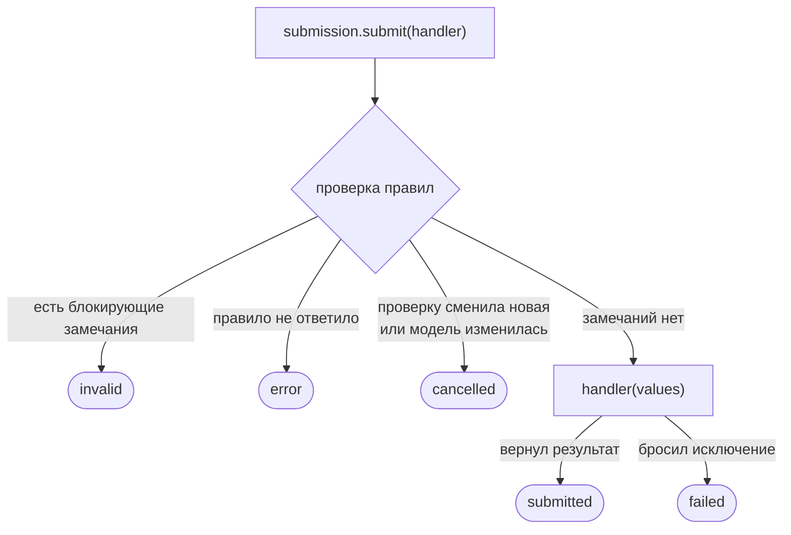
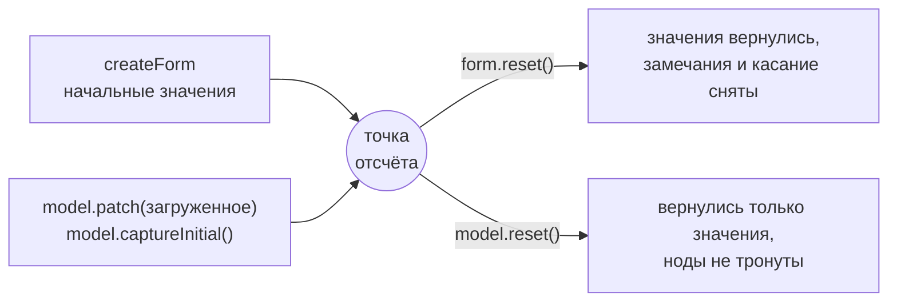

import ServerError from '@site/src/components/demo/live/patterns/server-error';
import serverErrorSource from '@site/src/components/demo/live/patterns/server-error.tsx?raw';

# Отправка и сброс

[Отправка](../reference/glossary.md) проверяет всю форму и, если блокирующих замечаний нет,
вызывает ваш обработчик со значениями модели. Сброс возвращает форму к исходным значениям. Оба
действия — у [сборки формы](../reference/glossary.md): `bundle.submission.submit(handler)` и
`form.reset()`.

## Когда нужно

- Кнопка «Отправить»: проверить, отправить на сервер, показать итог.
- Сервер отклонил данные — показать ошибку у конкретного поля.
- Кнопка «Сбросить» и чистая форма после успешной отправки.
- Сброс к данным, загруженным с сервера, а не к пустой форме.

## Пример

<LiveExample
  component={ServerError}
  source={serverErrorSource}
  caption="Что попробовать: отправьте форму пустой — итог invalid. Введите логин admin и верный email — «сервер» вернёт ошибку, и она появится у поля логина. Исправьте логин — замечание исчезнет, а отправка пройдёт и очистит форму."
/>

Что здесь происходит:

1. `signup.submission.submit(handler)` проверяет все правила. При замечаниях обработчик не
   вызывается.
2. Обработчик отправляет значения «на сервер». Ошибку сервера он кладёт в поле:
   `form.username.setIssues([{ code, params }])`. Текст кода даёт словарь формы.
3. По `outcome.status` видно, чем закончилась отправка. При успехе `form.reset()` очищает форму.
4. Стратегия `afterFirstSubmit` после первой отправки перепроверяет поля на ввод — правка логина
   заменяет ошибку сервера результатом правил.

## Итоги отправки



`submit` не бросает исключений: любой исход приходит объектом `SubmitResult`.

```typescript
type SubmitResult<R> =
  | { status: 'submitted'; result: R } // обработчик отработал
  | { status: 'invalid' | 'error' | 'cancelled'; validation: ValidationResult } // не вызывался
  | { status: 'failed'; error: unknown }; // обработчик бросил исключение
```

| `status`    | Что произошло                                                                    | Кто стал тронутым               |
| ----------- | -------------------------------------------------------------------------------- | ------------------------------- |
| `submitted` | правила прошли, обработчик вернул `result`                                       | поля, которые проверяли правила |
| `invalid`   | есть блокирующие замечания; предупреждения (`severity: 'warning'`) не блокируют  | вся форма                       |
| `error`     | асинхронное правило не вернуло ответ — причины в `validation.failures`           | вся форма                       |
| `cancelled` | проверку сменила следующая, модель изменилась во время проверки или сборку сняли | никто                           |
| `failed`    | правила прошли, обработчик бросил исключение — оно в `error`                     | поля, которые проверяли правила |

- Обработчик получает значения модели целиком, в том числе вычисляемые и выключенные поля. Лишнее
  для сервера отрежьте в обработчике или очищайте поле при выключении —
  `enableWhen(…, { resetOnDisable: true })`.
- Пока ждёт ответа асинхронное правило, форма не заперта. Если пользователь за это время поправил
  поле, итог — `cancelled`: правила не видели новых значений. Отправку просто повторяют.
- `validation` в итогах `invalid` и `error` — полный результат проверки: по нему, например,
  переводят мастер на шаг с первой ошибкой.

Отправка — это попытка отправки: стратегия `afterFirstSubmit` после неё включает живую проверку.
`bundle.validate()` проверяет форму без отправки и живую фазу не включает (см.
[Стратегии валидации](../validation/validation-strategies.md)).

## Ошибка сервера в поле

Бизнес-ошибку сервера кладите в поле методом `setIssues` — прямо в обработчике. Значения формы не
трогайте: пользователь их исправит.

```tsx
import { defineIssueMessages } from '@reformer/core/i18n';

const signupMessages = defineIssueMessages({
  'username.taken': 'Логин «{username}» уже занят',
});

const outcome = await signup.submission.submit(async (values) => {
  const reply = await api.register(values);
  if (reply.error === 'USERNAME_TAKEN') {
    signup.form.username.setIssues([
      { code: 'username.taken', params: { username: values.username } },
    ]);
  }
  return reply;
});
```

- Словарь подключает `ValidationMessagesProvider messages={signupMessages}` из `@reformer/cdk`.
- Замечание сервера снимет следующая проверка поля: живая стратегия — при правке, иначе — следующая
  отправка. Снять вручную — `form.username.clearIssues()`.
- Сбой сети в обработчике приходит итогом `failed`, а не исключением.

## Индикация отправки

У сборки два сигнала: `bundle.validating` — идёт проверка, `bundle.submission.submitting` — работает
обработчик. В компоненте их читает хук `useSignalSnapshot` из `@reformer/core/react`: он
перерисовывает компонент, когда сигнал меняется.

```tsx
import type { FormBundle } from '@reformer/core';
import { useSignalSnapshot } from '@reformer/core/react';

function SubmitButton({ bundle }: { bundle: FormBundle<Signup> }) {
  const validating = useSignalSnapshot(bundle.validating);
  const submitting = useSignalSnapshot(bundle.submission.submitting);
  return (
    <Button type="submit" disabled={validating || submitting}>
      {submitting ? 'Отправка…' : 'Отправить'}
    </Button>
  );
}
```

Мастер `FormWizard` делает это сам: его кнопки заблокированы на время проверки и отправки.

## Сброс формы

Значениями владеет модель, состоянием полей (замечания, касание, признак «изменено») — ноды формы.
Точка отсчёта у них одна: значения, с которыми создана модель, либо последние зафиксированные
вызовом `model.captureInitial()`.



| Вызов                    | Что делает                                                                                                    |
| ------------------------ | ------------------------------------------------------------------------------------------------------------- |
| `form.reset()`           | значения — к точке отсчёта; замечания, касание и «изменено» сняты. После него ни форма, ни модель не изменены |
| `form.reset(values)`     | то же, но к переданным значениям                                                                              |
| `model.reset()`          | только значения — к точке отсчёта; состояние нод не трогает, замечания погаснут при следующей проверке        |
| `model.captureInitial()` | сделать текущие значения новой точкой отсчёта — например, после загрузки с сервера                            |
| `model.isDirty()`        | отличаются ли значения от точки отсчёта                                                                       |

Кнопка «Сбросить» и чистый старт после успешной отправки — `form.reset()`. Если данные пришли с
сервера, зафиксируйте их точкой отсчёта сразу после загрузки — тогда `form.reset()` вернёт к
загруженному, а не к пустой форме:

```tsx
import type { FormBundle } from '@reformer/core';

async function loadSignup(bundle: FormBundle<Signup>) {
  bundle.model.patch(await api.getSignup());
  bundle.model.captureInitial(); // загруженное — новая точка отсчёта
}

function ResetButton({ bundle }: { bundle: FormBundle<Signup> }) {
  const handleReset = () => {
    if (!bundle.model.isDirty()) return; // нечего сбрасывать
    if (!confirm('Отменить изменения?')) return;
    bundle.form.reset(); // к загруженному; замечания и касание сняты
  };

  return (
    <Button type="button" onClick={handleReset}>
      Отменить изменения
    </Button>
  );
}
```

:::note Вычисляемые поля и `resetOnDisable`
Цели `compute` сброс не пишет: их пересчитает поведение, когда вернутся источники, и в `isDirty()`
они не входят. Поле, выключенное `enableWhen(…, { resetOnDisable: true })`, очищается к значению,
с которым создана его нода, а не к загруженному.
:::

## Снятие сборки

Сборку снимает её владелец — тот, кто вызвал `createForm`. `bundle.dispose()` снимает поведение,
подписки нод и живую проверку. Идущие проверки и отправка получают `cancelled`, их замечания на
поля не ложатся. Значения модели остаются; повторный вызов ничего не делает.

- В React сборку из `useFormBundle(() => createForm(...))` снимает сам хук — при размонтировании
  компонента.
- Вне React — в тесте, на сервере — снимайте сами:

```typescript
const signup = createForm<Signup>({
  initial: { username: '', email: '' },
  validation: signupRules,
});
try {
  const outcome = await signup.submission.submit((values) => api.register(values));
  expect(outcome.status).toBe('invalid');
} finally {
  signup.dispose();
}
```

Форму из `createFormFromModel`, без сборки, снимает `disposeForm(form)`.

## Подводные камни

- **Проверяйте `status`, а не сам итог.** `if (await submit(...))` всегда истинно: итог — объект.
- **Ждите итог через `await`.** Отправка дожидается асинхронных правил и обработчика.
- **Не сбрасывайте форму до ответа сервера.** Сброс — по итогу `submitted` и успешному ответу.
- **Отправка в обход проверки** (`api.send(bundle.model.get())`) пропускает правила: замечаний
  пользователь не увидит.
- **Обработчик вызвался, а у поля замечание?** Это предупреждение (`severity: 'warning'`): оно
  отправку не блокирует.

## См. также

- [Обзор валидации](../validation/overview.mdx) — правила, коды и тексты замечаний.
- [Обработка ошибок](../validation/error-handling.md) — замечания, сбой проверки.
- [Асинхронная предзагрузка](./async-preload.md) — загрузка значений с сервера.
- [Модель данных](../core-concepts/model) — `patch`, `reset`, `captureInitial`.
- [Частые проблемы](/docs/reference/faq) — например, ошибки на пустых полях после сброса.
