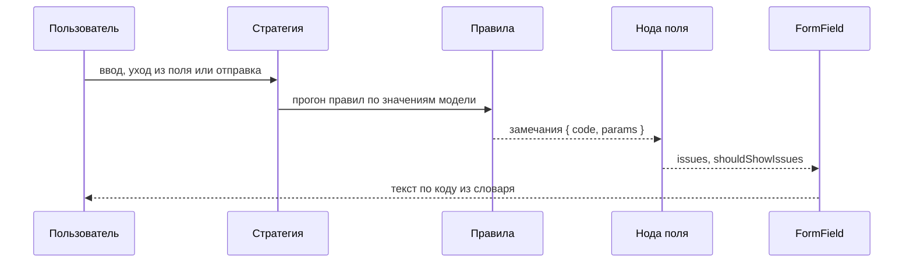

import SignupForm from '@site/src/components/demo/live/validation/signup-form';
import signupFormSource from '@site/src/components/demo/live/validation/signup-form.tsx?raw';

# Обзор валидации

Валидация проверяет значения формы по [правилам](../reference/glossary.md) и показывает
[замечания](../reference/glossary.md) у полей. Правила пишутся отдельно от разметки — функцией над
моделью — и подключаются к сборке формы.

## Когда нужно

- Поле обязательно или должно иметь формат: email, длина, диапазон чисел, дата.
- Поле зависит от другого: «Повторите пароль» должно совпасть с паролем.
- Ответ знает только сервер: «логин занят» — это [асинхронная валидация](./async.mdx).

## Пример

<LiveExample
  component={SignupForm}
  source={signupFormSource}
  caption="Что попробовать: введите пароль короче 8 символов, затем повторите его с опечаткой. Исправьте пароль — замечание у повтора пересчитается само. «Проверить» покажет замечания и у нетронутых полей."
/>

Что здесь происходит:

1. `defineValidation` описывает правила формы. `validate(model.$.email, [required(), email()])`
   ставит правила на поле: каждое правило проверяет одно значение.
2. `cross(model.$.confirm, passwordsMatch)` — правило над несколькими полями. Оно получает снимок
   всей формы и вешает замечание на `confirm`.
3. `validation: { rules, strategy: 'change' }` отдаёт правила сборке. [Стратегия](./validation-strategies.md)
   решает, когда проверять: здесь — на каждый ввод.
4. `FormField` показывает текст замечания. Встроенные коды переводит локаль, текст своего кода
   `confirm.mismatch` даёт словарь формы `defineIssueMessages`.

## Как проходит проверка



- **Стратегия** выбирает момент прогона: при отправке, при уходе из поля, на каждый ввод или вживую
  после первой отправки. Подробно — в [Стратегиях валидации](./validation-strategies.md).
- **Прогон** проверяет правила по текущим значениям модели. Поле, у которого замечаний не осталось,
  гасится само.
- **Замечание** несёт код и параметры, но не текст: `{ code: 'minLength', params: { minLength: 8 } }`.
- **Текст** подставляется при показе. Поэтому смена языка переводит уже показанные замечания без
  повторной проверки.
- **Показ.** Живая проверка не отмечает поля [тронутыми](../reference/glossary.md):
  `FormField` показывает замечание, когда поле трогали или меняли (`shouldShowIssues`).

## Правила и операторы

Правила — фабрики из `@reformer/core/validators`: `required()`, `email()`, `min(18)`. Фабрику
вызывают со скобками прямо в массиве: `validate(model.$.age, [required(), min(18)])`. Полный
список — в [Встроенных валидаторах](./built-in.md), свои правила — в
[Кастомных валидаторах](./custom.md).

Операторы схемы валидации — из `@reformer/core/validation`. Они работают только внутри
`defineValidation`:

| Оператор                         | Что делает                                                             |
| -------------------------------- | ---------------------------------------------------------------------- |
| `validate(поле, [правила])`      | синхронные правила поля                                                |
| `validateAsync(поле, [правила])` | правила с запросом к серверу, см. [Асинхронную валидацию](./async.mdx) |
| `cross(поле, check)`             | правило над несколькими полями; `cross` приходит аргументом схемы      |
| `validateWhen(условие, () => …)` | правила, которые действуют, только пока условие истинно                |
| `apply(model.$.группа, правила)` | правила вложенной группы: адрес, созаёмщик                             |
| `applyEach(model.$.массив, …)`   | правила каждой строки массива                                          |

## Запуск проверки

Сборка формы проверяет правила сама. Вызывать раннер вручную не нужно.

| Вызов                               | Когда                                    | Что возвращает                   |
| ----------------------------------- | ---------------------------------------- | -------------------------------- |
| живая стратегия (`strategy`)        | на ввод или уход из поля, без вызова     | —                                |
| `bundle.validate()`                 | кнопка «Проверить»                       | `ValidationResult`               |
| `bundle.submission.submit(handler)` | отправка: проверить и вызвать обработчик | `SubmitResult`                   |
| `bundle.validateStep(id)`           | проверить один шаг многошаговой формы    | `ValidationResult`               |
| `bundle.flow.next()`                | «Далее»: проверить шаг и перейти         | итог перехода (`FlowTransition`) |

Статус `ValidationResult`:

| `status`    | Что значит                                                                         |
| ----------- | ---------------------------------------------------------------------------------- |
| `valid`     | блокирующих замечаний нет; предупреждения (`severity: 'warning'`) не блокируют     |
| `invalid`   | есть блокирующие замечания                                                         |
| `error`     | асинхронное правило не вернуло ответ — см. [Обработку ошибок](./error-handling.md) |
| `cancelled` | прогон устарел: следом запущен новый для тех же модели и правил                    |

Отправку и её итоги разбирает страница [Отправка и сброс](../patterns/submit-and-reset.mdx).

:::info Без сборки
Если формы нет — server action, юнит-тест — те же правила проверяет раннер
`validateModel(model, rules)` из `@reformer/core/validation`. Он возвращает `true` только при
статусе `valid`. Полный результат без записи в ноды даёт `runValidation(model, rules)`.
:::

## Объект замечания

Замечание — `ValidationIssue`. Текста в нём нет:

```typescript
interface ValidationIssue {
  code: string; // встроенный код ('required', 'minLength') или свой ('confirm.mismatch')
  params?: Record<string, unknown>; // значения для текста: { minLength: 8, actualLength: 3 }
  severity?: 'error' | 'warning'; // 'error' по умолчанию блокирует отправку, 'warning' — нет
}
```

Замечания поля лежат в его ноде: `form.password.issues.value`. В компоненте их читает
`useFormControl(form.password).issues` — см. [Обработку ошибок](./error-handling.md).

## Тексты замечаний

Текст ищется по коду замечания в таком порядке:

1. **словарь формы** — запись по коду в `defineIssueMessages`: текст конкретной формы или поля;
2. словарь **активной локали** (`I18nProvider`) — тексты встроенных кодов;
3. встроенный английский текст ядра;
4. сам код — если его нет ни в одном словаре.

Для встроенных правил словарь писать не нужно: их переводит локаль. Свой текст поля — это свой код
правила и запись в словаре формы:

```tsx
import { defineIssueMessages } from '@reformer/core/i18n';
import { ValidationMessagesProvider } from '@reformer/cdk';

// Правило несёт только код…
validate(model.$.loanAmount, [required({ code: 'loanAmount.required' }), min(50000)]);

// …текст живёт в словаре. Шаблон подставляет параметры правила; можно и функцию.
const creditMessages = defineIssueMessages({
  'loanAmount.required': 'Укажите сумму кредита',
  min: (params, i18n) => `Не меньше ${i18n.number(Number(params.min))} ₽`,
});

<ValidationMessagesProvider messages={creditMessages}>
  <CreditFormView />
</ValidationMessagesProvider>;
```

`FormField` из `@reformer/ui-kit` и `@reformer/cdk` берёт текст у ближайшего
`ValidationMessagesProvider`. В своём компоненте текст даёт `useIssueMessage(messages)` из
`@reformer/core/react`, вне React — `resolveIssueMessage(issue, i18n, messages)` из
`@reformer/core/i18n`.

## Условная валидация

Правила, которые нужны только в части формы, оборачивают в `validateWhen(условие, () => …)`. Пока
условие ложно, правила внутри не проверяются, а замечания их полей снимаются.

```typescript
const orderValidation = defineValidation<OrderForm>(({ model }) => {
  validate(model.$.contactMethod, [required()]);
  // Телефон обязателен, только если выбрана связь по телефону.
  validateWhen(
    () => model.contactMethod === 'phone',
    () => validate(model.$.phone, [required()])
  );
});
```

Условие читает значение (`model.contactMethod`), а правило ставится на сигнал поля
(`model.$.phone`). `validateWhen` не выключает поле: сделать его недоступным — дело
[поведения](../behaviors/conditional.md) (`enableWhen`).

## Подводные камни

- **Правила — константа модуля.** Устаревший прогон отменяется по паре «модель + правила». Новая
  функция правил на каждый рендер ломает отмену.
- **Правил в узлах схемы нет.** Ключи `validators`, `updateOn`, `debounce` в узле поля сборка не
  читает. Правила — в `defineValidation`, момент проверки — в `strategy`.
- **`cross` видит снимок.** Он не следит за соседним полем сам: правило над двумя полями
  пересчитывает живая стратегия или следующая проверка.
- **Свой код без записи в словаре** показывается как есть — `confirm.mismatch`. Каждому своему коду
  нужна запись в `defineIssueMessages`.
- **Отправку и проверку ждите через `await`.** Прогон всегда асинхронный, даже без асинхронных правил.

## См. также

- [Стратегии валидации](./validation-strategies.md) — когда показывать замечания.
- [Встроенные валидаторы](./built-in.md) — все фабрики, коды и параметры.
- [Асинхронная валидация](./async.mdx) — проверка через сервер.
- [Обработка ошибок](./error-handling.md) — чтение замечаний, ошибки сервера, сбой правила.
- [Локализация](/docs/guides/localization) — тексты замечаний на нескольких языках.
- [Тестирование форм](/docs/guides/testing) — как проверить правила без браузера.
